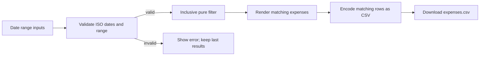

# Date Range Filter and CSV Export Architecture

## Scope and decisions

The pilot is an in-memory browser application with no server or database. This feature adds no persistence migration. Store dates as validated ISO calendar-date strings (`YYYY-MM-DD`); lexical comparison is correct for validated, zero-padded dates. Keep filtering and CSV encoding as pure functions so they can be tested independently from browser APIs.

## Data model

```text
Expense {
  description: string (required, trimmed)
  amount: number (finite and > 0)
  date: string (required, valid YYYY-MM-DD calendar date)
}
DateRange {
  startDate: string | null
  endDate: string | null
}
```

Existing expense records already contain `date`; no database schema update is needed. A future persistent store should retain a database `DATE` column and map it to ISO date strings at the API boundary.

## API contract (client module)

`filterExpensesByDateRange(expenses, { startDate?, endDate? }) -> Expense[]`

- Inclusive endpoints, either optional.
- Throws `RangeError` when both valid endpoints are supplied with start after end.
- Throws `TypeError` for malformed or impossible supplied dates.
- Preserves input order and does not mutate the collection.

`expensesToCsv(expenses) -> string`

- Emits `date,description,amount` plus CRLF separated records.
- Quotes fields containing comma, quote, CR, or LF; doubles quotes.
- Emits the header for an empty collection.

The browser layer wires date input changes to the filter function, presents validation errors without replacing the prior valid results, and downloads a `text/csv;charset=utf-8` Blob as `expenses.csv`.

## Flow



## Security and correctness

CSV quoting follows RFC 4180 field escaping. Spreadsheet formula interpretation is a separate risk from CSV syntax; exported text fields beginning with `=`, `+`, `-`, or `@` are prefixed with an apostrophe to reduce formula execution risk. Amounts remain numeric and validated positive before export. No secrets or external service calls are involved.
