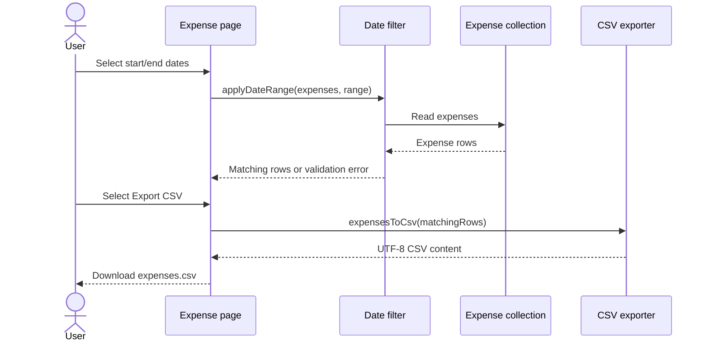

# Date Range Filter and CSV Export

## Goal

Let a user narrow the expense list to an inclusive date range and export exactly the visible matching rows as a CSV file.

## Acceptance criteria

- Both range endpoints are inclusive and interpreted as calendar dates (`YYYY-MM-DD`).
- With no endpoints, all expenses remain visible; either endpoint may be used on its own.
- A start date after the end date is rejected with an actionable validation message and does not change the visible results.
- CSV headers are `date,description,amount`; each matching expense is emitted once in the current stable date order.
- CSV values containing commas, quotes, or line breaks are quoted and embedded quotes are doubled.
- An empty result exports a header-only CSV.
- Export uses UTF-8 text with a `.csv` filename and does not mutate the expense collection.

## Gherkin scenarios

```gherkin
Feature: Filter expenses by date and export matching rows

  Scenario: Filter inclusively by both dates
    Given expenses dated "2026-04-01", "2026-04-15", and "2026-04-30"
    When I filter from "2026-04-15" through "2026-04-30"
    Then I see the expenses dated "2026-04-15" and "2026-04-30"

  Scenario: Filter with only a start date
    Given expenses dated "2026-04-01" and "2026-04-15"
    When I filter from "2026-04-10" with no end date
    Then I see only the expense dated "2026-04-15"

  Scenario: Reject an inverted range
    When I filter from "2026-04-20" through "2026-04-10"
    Then I see a date range validation message
    And the previous results remain unchanged

  Scenario: Export filtered results with CSV escaping
    Given a matching expense with description "Lunch, \"team\""
    When I export the filtered results
    Then the CSV contains the header "date,description,amount"
    And the description field is quoted with embedded quotes doubled

  Scenario: Export no matching expenses
    Given no expenses match the selected dates
    When I export the filtered results
    Then the CSV contains only the header row
```

## Sequence diagram


